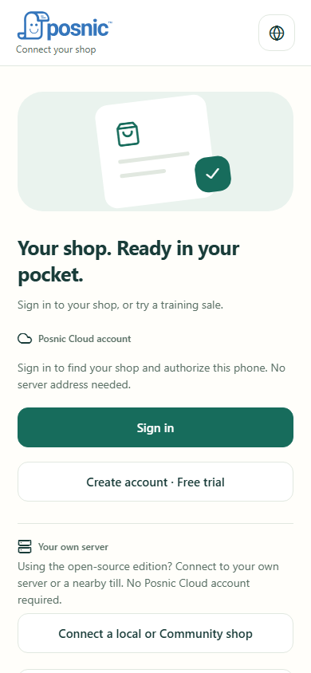
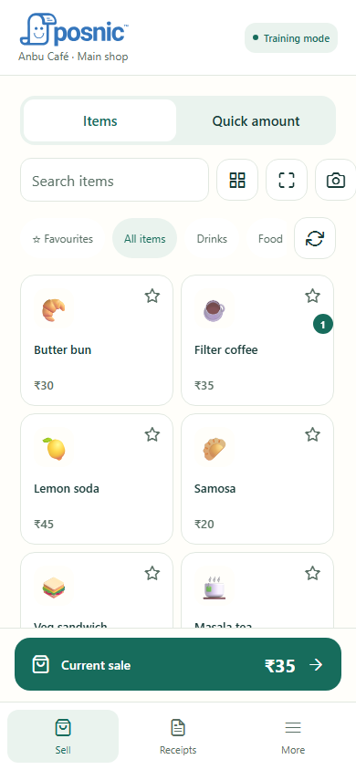
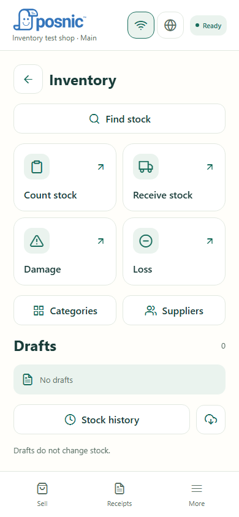
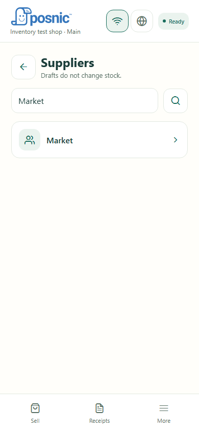
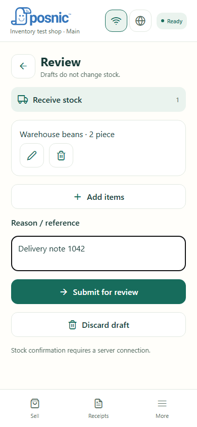
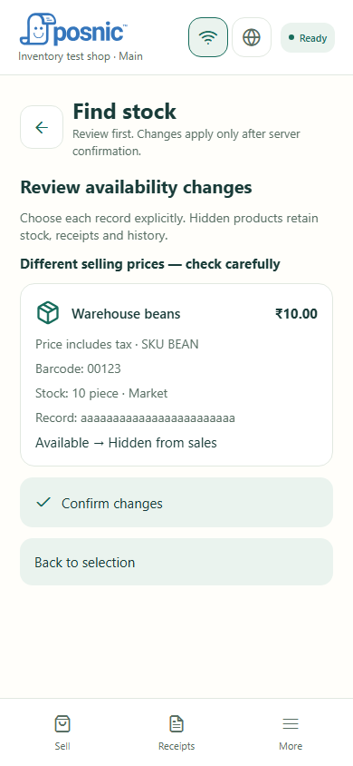

# Posnic Mobile POS

An open-source mobile till for retail shops and restaurants: sell, scan products, collect cash, print receipts and manage stock with your existing Posnic shop.

**[Download the latest Android APK](https://github.com/Posnic/Mobile-App/releases/latest)** · [Connection guide](docs/CONNECTION_AND_PIN.md) · [User guide](docs/USER_GUIDE.md) · [Developer setup](docs/DEVELOPMENT.md)

Open the release and choose the `.apk` under **Assets**. The current release is **0.3.0-beta.30**, an Android ARM64 pilot build. GitHub's **Latest** label identifies the recommended download; this remains beta software. iPhone builds require a separately processed and assigned TestFlight build; this link does not install an iPhone app.

## See the app

Screens below come from the running app with test data, not separate mockups. Native controls and shop permissions can change what appears.

| Connect your shop | Sell and scan | Inventory |
| --- | --- | --- |
|  |  |  |

| Supplier selection | Review stock changes | Duplicate-barcode review |
| --- | --- | --- |
|  |  |  |

[More screenshots and capture details](docs/screenshots/README.md).

## Start in a few steps

1. Install the APK from the latest release. For an existing installation, update in place; keep app data so pending sales and drafts remain intact.
2. Choose **Sign in** for Posnic Cloud, **Create account · Free trial**, or **Connect a local or Community shop** for your own server. You can also **Try a training shop** without connecting; training sales never upload.
3. Authorize the phone in the browser for Cloud. For a local shop, discover and select the shop on Wi-Fi, scan its pairing QR, or use a server address and credentials/pairing code.
4. Let the first catalogue download finish. Start selling. A local unlock PIN is optional and can be enabled later under **More**.

You need a compatible [Posnic POS server](https://github.com/Posnic/POS/releases) with Mobile POS enabled for your branch and permissions for your staff account. Older servers without `mobilePosV1` need updating. Cloud browser approval additionally depends on the matching account/gateway service. See [setup and troubleshooting](docs/CONNECTION_AND_PIN.md).

## What you can do

| Area | Available in this app |
| --- | --- |
| Sales | Item tiles, favourites, search, hidden numeric quick codes, camera barcode/QR scanning, weighed quantities, quick amount sales, customers, held carts, cash/change and receipts. |
| Products | Create items with barcode scanning, label-photo text assistance, category/supplier/tax selection and optional tracked opening stock. Save and scan the next product. Requires item-management permission and server confirmation. |
| Photo assistance | Read a product label or paper order into a reviewable draft; match existing products and correct quantities before adding to the sale. Recognition is assistance, not automatic checkout. |
| Inventory | Find stock, supplier/category filters, count, receive, damage, loss, persistent drafts, review, confirmation and operation history. Uses the server's existing stock records and approval policy. |
| Duplicate barcodes | Compare all primary/alternate barcode matches, including hidden products. Review and explicitly hide/restore selected records with **Available for sale**. No automatic merge, stock sum or deletion. |
| Payments | Cash and branch-configured UPI QR selection. UPI confirmation is recorded by staff; it is not bank/provider verification. |
| Printing | Configured till/server, OS print service, or supported Android Bluetooth Classic/USB ESC/POS printers. Downloaded shop receipt layouts support local printing; printer-connected cash drawers are supported. |
| Connections | Separate Wi-Fi and globe buttons for manual selection of remembered shop connections. Discovery shows shop names where advertised. QR, pairing-code and manual-address alternatives remain available. |
| Offline | Downloaded catalogue and images, cash sales under a valid offline grant, local receipts, direct printing and saved inventory/product drafts. Pending sales retry on reconnection to their original ledger. |
| Languages | English, Tamil, Hindi, Malayalam, Kannada, Telugu, Sinhala, Nepali, Arabic, French, Spanish, Portuguese, Indonesian, Thai, German, Swahili, Dutch and Italian. Arabic RTL; bundled offline packs. Non-English translations remain beta. |

## Wi-Fi and Internet are explicit choices

Tap **Wi-Fi** for the shop's local till or the **globe** for its Internet connection. The app remembers each connection's session. It does **not automatically switch between independent Wi-Fi and cloud servers** or move unsent orders to a different database.

The same shop name does not prove two servers share a sales ledger. Pending sales/print requests and active or parked baskets can block a switch; resolve them on the original connection. Inventory drafts and receipts retain their server association. An offline till cannot receive another device's product or stock changes until normal server sync reconnects.

## Offline capacity and limits

- All downloaded catalogue items remain searchable; the receipt-history limit does not cap items. Images are available offline once downloaded.
- Receipt cleanup defaults to **90 days / 10,000 eligible synced receipts**. Pending sales, unresolved print work and other protected records are excluded; this is not a hard database-size ceiling.
- Initial authorization and catalogue download need a reachable server. Offline selling is bounded by the server-issued grant; PIN unlock does not extend it.
- Stock observations and new-product entries can be drafted offline. Applying stock changes, creating live items and changing availability require server confirmation. Inventory operations support up to **200 lines** each.
- A directly connected supported Android printer can print without the POS server. Server/till printing needs that server. Electronic payments and OS printer services have their own connectivity requirements.

## Printing and hardware

Use **More → Devices / Printing** to configure the available route. The shop receipt design downloads with the authenticated catalogue for supported 58/80 mm printing. Embedded logos can print offline after download; arbitrary external image URLs are not downloaded. If there is no saved design, the standard receipt is used.

USB/Bluetooth printer support is Android-specific; iPhone uses system or configured till printing. A successful transport write is not proof that paper emerged. Check an uncertain job before reprinting. Keyboard/HID scanners are supported; integrated card terminals, NFC/Tap to Pay, weighing-scale adapters and provider-confirmed payments remain future integrations. See [device setup and limitations](docs/DEVICES.md).

## Guides

- [Everyday use: sales, new products, stock, duplicates and troubleshooting](docs/USER_GUIDE.md)
- [Cloud/local connection, switching and optional PIN](docs/CONNECTION_AND_PIN.md)
- [Inventory setup, confirmation and limits](docs/MOBILE_INVENTORY_IMPLEMENTATION.md)
- [Availability, duplicate barcodes and synchronization](docs/product-availability.md)
- [Photo orders](docs/PHOTO_ORDERS.md), [languages](docs/LANGUAGES.md) and [gestures](docs/MOBILE_GESTURES.md)
- [Permissions](docs/ACCESS_CONTROL.md), [offline testing](docs/OFFLINE_DIRECT_PRINT_BETA.md) and [release scope](docs/IMPLEMENTATION_STATUS.md)
- [Build and test locally / iOS signing](docs/DEVELOPMENT.md), [API contract](docs/MOBILE_API.md) and [roadmap](docs/MOBILE_POS_ROADMAP.md)

Browser tests cover the web flows; they do not replace installed-phone, physical printer or multi-till acceptance testing. The app is a focused till and inventory companion, not the desktop's complete reporting, purchasing or administration suite.

Built with React Native, Expo and TypeScript. Licensed under [AGPL-3.0-only](LICENSE).
