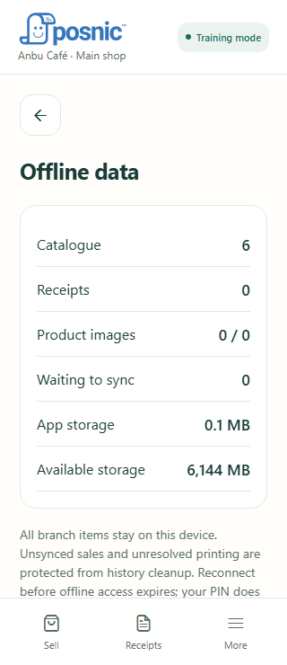

# Using Posnic Mobile POS

[Download Android](https://github.com/Posnic/Mobile-App/releases/latest) | [Connect your shop](CONNECTION_AND_PIN.md) | [README](../README.md)

## Make a sale

1. Open **Sell**, then tap a product tile, search, or use the barcode scan icon. Scanning matches the shop catalogue; it does not fetch a product from an external database.
2. Ordinary items increase quantity when selected. Weighed items ask for their quantity in the displayed unit, with up to three decimal places.
3. For an amount-only sale, choose **Quick amount** if your branch and role allow it. Add a customer when needed.
4. Review the basket and collect cash or use a configured UPI QR. Check UPI receipt independently before confirming; the app records staff confirmation, not bank confirmation.
5. Complete the sale, then print through the configured route. **Receipts** shows this device's receipts and sync state, not every sale made by all staff.

Use the photo icon separately from the barcode icon for product-label or paper-order text recognition. Review matches and quantities before adding them. Uncertain recognition must be corrected by the operator.

## Add a product and opening stock

With item read/write permission, open **More → Create item** (or **New item** in an empty catalogue).

1. Scan the product barcode or enter it. Review existing primary/alternate barcode matches, including hidden records, before creating another item.
2. Optionally capture a label photo to assist name, brand and SKU entry. Enter the selling price and choose the server's category, supplier and tax settings.
3. Enable **Track stock** and optionally enter opening stock. Zero is valid; configured weighed products support fractional quantities.
4. Review and save. **Save & scan next** helps initial shelf setup; **Save & add to sale** refreshes the authorized catalogue before adding to the basket.

An offline product draft is not yet a live sellable item. Wait for server confirmation. Opening stock is recorded once with an audit; use **Receive stock** for later deliveries.

## Set up inventory access

In the matching desktop/server, open **Core Settings → Inventory → Mobile inventory**. Mobile inventory defaults to enabled when no policy exists; an administrator's explicit disable is preserved. Save the policy for the correct branch. Selected count/receive/damage/loss approval options require manager approval; otherwise authorized item writers confirm directly.

Give staff existing **item read** permission to view inventory and **item write** permission to change it. Refresh the mobile catalogue/connection after changing permissions or policy. Open **More → Inventory**; inventory-only staff may start there automatically. If missing, check the same shop, branch, selected Wi-Fi/Internet server, server version and role rather than enabling an unrelated expiry reminder.

## Count or receive stock

1. Choose **Count stock**, **Receive stock**, **Damage** or **Loss**.
2. Search or scan products. Choose a supplier/category to filter products. A supplier filter does not create a supplier invoice or link a purchase order.
3. Enter the physical total for a count, or the movement quantity for receiving/damage/loss. A counted zero is different from an uncounted item.
4. Open **Review**, check every line and submit/confirm as allowed by the server policy. Drafts do not change stock.
5. Check the returned status. **Complete** means confirmed effects; approval-pending, conflict and unconfirmed requests need attention. Do not resubmit the same work as a new operation after a timeout. Refresh its existing status first.

Operations have a 200-line limit. Offline observations stay on the phone until the original server can review them. Changed server stock can require recounting a line. Completed operations belong in stock history; drafts remain editable only while their operation permits it. Do not finalize a physical reconciliation while other tills still have unsent sales.

## Fix duplicate barcode matches

1. Open **Inventory → Find stock** and scan the barcode, or open product availability review.
2. Compare **all** primary and alternate matches, including hidden products: name, image, SKU, barcode, tax-inclusive selling price, stock and supplier. Different prices are highlighted.
3. Leave the correct record **Available for sale**. Turn that setting off only for the unwanted records.
4. Review exactly which records will change, then confirm online. Wait for server-confirmed results; a selection or failed request is not confirmation.
5. Refresh/sync desktop and mobile sales catalogues, then scan again. To undo, find the hidden record in inventory and restore **Available for sale**, confirm and sync.

This hides products from selling, not inventory. Stock, receipts and historical sales are preserved. It does not merge, delete, sum quantities or rewrite barcodes. An existing basket containing a newly hidden item remains intact and needs an explicit remove/restore decision. Disconnected tills only learn the change on reconnect; already-paid offline sales keep their historical grant and receipt.

## Offline and sync status

**More → Connection & sync** shows the selected server and waiting/attention states. **Offline data** shows downloaded data. Download before leaving the network, and check that required images are present. Saved categories, suppliers and items come from the shop; they are not a separate mobile stock system.

A shop-server acknowledgment and a cloud acknowledgment are different. Community servers may report only the former. Do not infer that the Internet server already has a Wi-Fi sale simply because the local server accepted it. Independent ledgers cannot safely exchange the phone's pending work by changing the connection.

## Common problems

| Symptom | What to check |
| --- | --- |
| No products | Refresh the catalogue, check selected branch/server and availability. Use New item only if the product really is new and your role permits it. |
| Cannot reach a local server | Phone and till must share a reachable network. Confirm the current till address, firewall and guest/hotspot isolation. A desktop's localhost address refers to the phone when entered on the phone. |
| Browser approval expired or rejected | Return to the app and start a fresh sign-in. Avoid reusing an old approval tab. If repeated, record the time, app version and shop address for support; do not share codes or passwords. |
| Wi-Fi and Internet show different data | Check the shop/branch and core server sync health. Switching the mobile route does not repair core replication. Keep pending work on its original server. |
| Confirmation timed out | Refresh the existing operation or receipt status before retrying. A lost reply does not prove the server did nothing. |
| Inventory option absent | Check Core Settings → Inventory → Mobile inventory, item permissions, matching API version and refresh the phone's grants. |
| Printing uncertain | Inspect printer/paper and the existing print job before requesting another copy. |

Never uninstall or clear storage to fix a connection problem while sales, stock observations or print jobs are unresolved. Keep the app version, exact error and selected connection when reporting an issue; avoid sending customer records or credentials.
